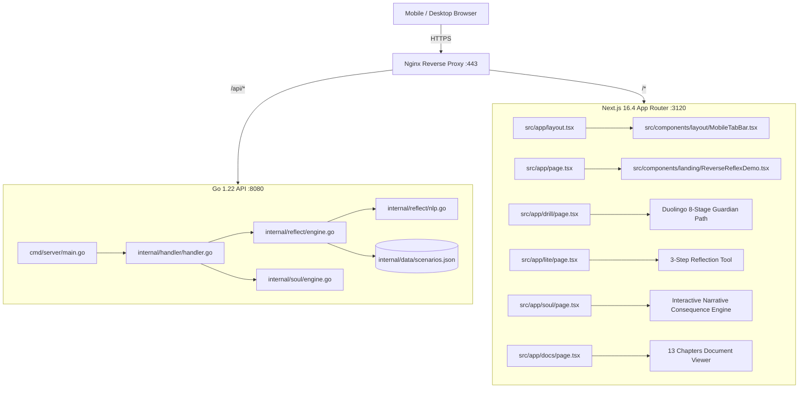

# Ruas AI-Native Memory & Working Context

> **LLM NOTICE:** This document is the pre-indexed semantic ground truth for **Anti Trap Order (ATO)**.
> Do NOT rescan ASTs blindly, do NOT inject raw unicode emojis into UI (use Lucide icons exclusively), and do NOT violate the core architectural invariants.

---

## 1. Active Vibe Intent & Working State
- **Current Intent:** 
  1. Complete transition from unicode emojis to clean vector icons (Lucide React).
  2. Maintain 10 authentic Indonesian social engineering scenarios across Go backend and Next.js frontend.
  3. Support Duolingo-style mobile daily drill (`/drill`) with tactile 3D interactions and thumb navigation.
  4. Keep Go backend micro-NLP engine running sub-5ms within VPS 1.9 GB RAM constraints.
- **Session Tag:** `ato-duolingo-drill-and-icons`
- **Active Files (Core Hubs):**
  - `src/app/drill/page.tsx` — Mobile daily drill with 8-stage skill tree, synthetic Web Audio chime, client-side streak & XP.
  - `src/components/layout/MobileTabBar.tsx` — Fixed thumb-friendly mobile navigation bar.
  - `src/components/landing/ReverseReflexDemo.tsx` — Desktop/mobile interactive perspective inversion simulator.
  - `src/data/scenarios.json` — 10 canonical scam scenarios with structured flaws and safe steps.
  - `internal/data/scenarios.json` — Go backend embedded scenario dataset (`go:embed`).
  - `internal/reflect/nlp.go` — Indonesian social engineering tokenizer and slang normalizer.
  - `internal/model/types.go` — Go API request/response structs and invariants.
  - `internal/handler/handler.go` — Chi/HTTP handlers with input sanitization.
  - `scripts/deploy.sh` — EC2 live synchronization and zero-downtime deployment script.

---

## 2. Architectural Invariants (Non-Negotiable Rules)

### Invariant 1: Perspective Inversion (Reverse Reflex)
- User must never be treated as a passive victim who receives an arbitrary percentage score (e.g. NEVER output "87% penipuan").
- The core pedagogy trains users to adopt the attacker's lens: *"What vulnerability is the attacker exploiting?"*, *"Why are they rushing you?"*, *"What happens if you verify externally?"*

### Invariant 2: Zero-Login & Zero-DB on Server (Stateless by Design)
- Server backend in Go has **no database** (no Postgres, no MySQL, no MongoDB).
- No session cookies, no personal identity collection, no phone number logging.
- Gamification state (daily streak, XP, completed drill stages) is stored purely in client-side `localStorage` (`ato_duolingo_drill_v1`).

### Invariant 3: Visual Design & Zero Raw Emojis
- **Never use raw unicode emojis in UI indicators.** Emojis break visual consistency across operating systems and look amateurish.
- Always use **Lucide React vector icons** (`Clock`, `Briefcase`, `UserX`, `Package`, `Truck`, `Smartphone`, `HeartCrack`, `Crown`, `Trophy`, `Compass`, `Zap`, `ShieldCheck`, `BookOpen`).
- Dark-first aesthetic (`#07090D` background, `#0B0F17` surfaces, `#10B981` emerald accents, `#8B5CF6` purple accents, `#F59E0B` amber warning accents).
- Tactile 3D-ish buttons for mobile interactions (`border-b-4 shadow-[0_6px_0_...] active:translate-y-1.5 active:shadow-none`).

### Invariant 4: Lightweight Rule-Based NLP vs. Local LLM
- VPS specification: `13.228.178.42` has 1.9 GB RAM total and 0 GPU.
- Running Ollama/llama.cpp triggers the Linux Out-Of-Memory (OOM) killer.
- The Indonesian social engineering tokenizer in `internal/reflect/nlp.go` normalizes chat slang (`tf`, `rek`, `apk`, `loker`, `pinjol`, `cair`) and detects 5 manipulation vectors in `< 5ms` with `< 5MB` RAM.

### Invariant 5: Data Contract Compatibility
- `SafeStep` must always be serialized as an object:
  ```json
  {
    "id": "step_id",
    "text": "Instruction text",
    "applies_to_tags": ["all"]
  }
  ```
  Never serialize `SafeStep` as a plain string in `scenarios.json` to avoid Go unmarshal errors.

---

## 3. Subsystem Architecture Map



---

## 4. 10 Canonical Indonesian Scenarios

| # | ID | Category | Threat Vector | Primary Flaw |
|---|---|---|---|---|
| 1 | `wfh_admin_fee` | `job_scam` | Upfront Fee | Pungutan biaya seragam/ID card di depan |
| 2 | `impersonate_blue_badge` | `impersonation` | Too Good To Be True | Akun centang biru tiruan minta OTP |
| 3 | `impersonate_new_number` | `family_emergency` | Urgency / Impersonation | Kerabat ganti nomor minta talangan dana |
| 4 | `phishing_bank_account_freeze` | `bank_phishing` | Urgency / Isolation | Ancaman blokir rekening dalam 1x24 jam |
| 5 | `loan_shark_no_bi_checking` | `loan_shark` | Predatory Terms | Pinjol ilegal minta akses kontak penuh |
| 6 | `apk_wedding_invitation` | `phishing` | Malware / APK | File .APK undangan pernikahan curi SMS OTP |
| 7 | `marketplace_cod_scam` | `marketplace` | Off-Platform Urgency | Tagihan COD kurir fiktif di depan rumah |
| 8 | `romance_investment_pigbutchering` | `impersonation` | Social Grooming | Kenalan kencan online ajak trading crypto |
| 9 | `task_scam_review_maps` | `job_scam` | Advance Fee Trap | Misi like video & deposit misi VIP bertingkat |
| 10 | `generic_emergency` | `custom_reflection` | Multi-vector | Kerangka analisis umum rekayasa sosial |

---

## 5. Deployment & Operations Runbook

- **Live URL:** `https://ato.kousozo.tech`
- **Host:** `ubuntu@13.228.178.42` (AWS EC2 Singapore)
- **Deployment Script:** `./scripts/deploy.sh`
- **PM2 Processes:**
  - ID 3: `anti-trap-order` (Next.js 16 on port 3120)
  - ID 4: `ato-backend` (Go API on port 8080)
- **Git Repo:** `https://github.com/fk0u/anti-trap-order` (Private repository)
