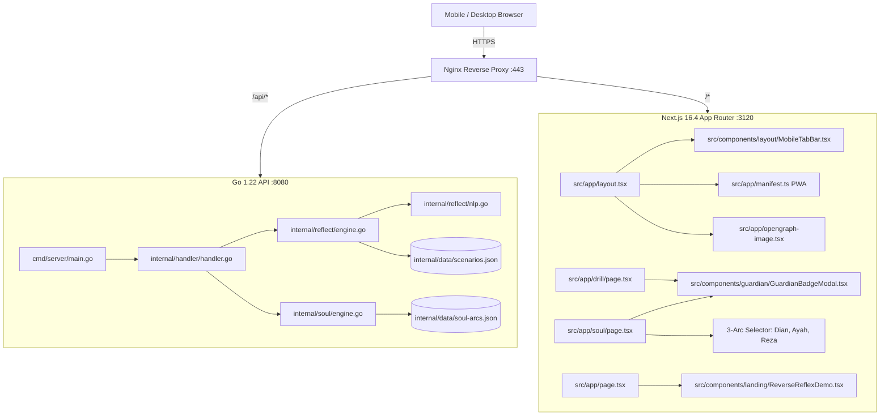

# Ruas AI-Native Memory & Working Context

> **LLM NOTICE:** This document is the pre-indexed semantic ground truth for **Anti Trap Order (ATO)**.
> Do NOT rescan ASTs blindly, do NOT inject raw unicode emojis into UI (use Lucide icons exclusively), and do NOT violate the core architectural invariants.

---

## 1. Active Vibe Intent & Working State
- **Current Intent:** 
  1. Completed 4 core pre-redesign foundations: PWA Manifest & App Icons, 3 Narrative Soul Arcs, Guardian Badge Generator with WhatsApp Share, and Dynamic 1200x630 OpenGraph SEO preview.
  2. Ready to transition into Phase 2: Comprehensive UI Redesign.
- **Session Tag:** `ato-pwa-soul-badge-og`
- **Active Files (Core Hubs):**
  - `src/app/manifest.ts` — Web App Manifest for Android/iOS standalone home screen installation.
  - `src/app/opengraph-image.tsx` — Dynamic 1200x630 social card generated on-demand via `next/og`.
  - `src/components/guardian/GuardianBadgeModal.tsx` — HTML5 Canvas 2D engine for high-res PNG certificate generation & WhatsApp sharing.
  - `src/app/soul/page.tsx` — Interactive narrative consequence engine with 3-arc selector.
  - `src/app/drill/page.tsx` — Duolingo-style daily reflex drill with badge claim trigger.
  - `src/app/layout.tsx` — Root layout with enhanced SEO, PWA, and OpenGraph metadata.
  - `src/data/soul-arcs.json` & `internal/data/soul-arcs.json` — 3 complete BFS-validated narrative arcs.
  - `src/data/scenarios.json` & `internal/data/scenarios.json` — 10 canonical scenarios with >=4 validated flaws each.
  - `scripts/deploy.sh` — EC2 live synchronization and zero-downtime deployment script.

---

## 2. The 4 Completed Foundations

### 1. PWA Standalone Mobile Installation
- **Manifest:** `src/app/manifest.ts` configured with `display: "standalone"`, `theme_color: "#07090D"`, and categories `["education", "security", "utilities"]`.
- **Icon Suite:** `public/icons/icon-192.png`, `public/icons/icon-512.png`, `public/icons/apple-touch-icon.png`, and `public/icons/icon.svg`.
- **Offline Behavior:** All simulation engines (`reflect-local.ts`, `soul-local.ts`, `localStorage` streak/XP) work 100% offline without cellular reception.

### 2. 3 Complete Narrative Soul Arcs
- **Arc 1: Misi Sampingan Dian (`arc_dian_parttime`)**:
  - *Ward:* Dian (19th, adik kuliah perantauan).
  - *Threat:* Skema ponzi tugas review Google Maps VIP di grup Telegram.
- **Arc 2: Panggilan Darurat Ayah (`arc_ayah_rekening`)**:
  - *Ward:* Pak Bambang (62th, pensiunan PNS di kampung).
  - *Threat:* Ancaman surat tilang palsu format `.APK` dan pembobolan SMS OTP tabungan hari tua.
- **Arc 3: Investasi Asmara Reza (`arc_sahabat_crypto`)**:
  - *Ward:* Reza (25th, sahabat karib).
  - *Threat:* Modus Sha Zhu Pan (Pig Butchering) berkedok wanita analis finansial di Bumble yang mengajak trading crypto bursa fiktif.
- **Graph Traversal:** 100% BFS reachability verified, zero dead-ends, 3 distinct endings per arc.

### 3. Guardian Badge & Certificate Generator
- Built inside `src/components/guardian/GuardianBadgeModal.tsx`.
- Generates high-res 1200x675 PNG certificate cards directly in the client via Canvas 2D context.
- Includes unique verification ID (`ATO-A20-XXXXXX`), user streak, total XP, and rank title.
- Supports 1-click WhatsApp viral share with personalized reflex challenge copy.

### 4. Dynamic OpenGraph & Meta SEO
- Generated dynamically via `src/app/opengraph-image.tsx`.
- Formatted with dark cyber-guardian styling (`#07090D`, emerald/cyan radial gradient, badge chips, and official ATO typography).
- Standard metadataBase set to `https://ato.kousozo.tech` in `src/app/layout.tsx`.

---

## 3. Subsystem Architecture Map

---

## 4. Deployment & Operations Runbook

- **Live URL:** `https://ato.kousozo.tech`
- **Host:** `ubuntu@13.228.178.42` (AWS EC2 Singapore)
- **Deployment Script:** `./scripts/deploy.sh`
- **PM2 Processes:**
  - ID 3: `anti-trap-order` (Next.js 16 on port 3120)
  - ID 4: `ato-backend` (Go API on port 8080)
- **Git Repo:** `https://github.com/fk0u/anti-trap-order` (Private repository)
